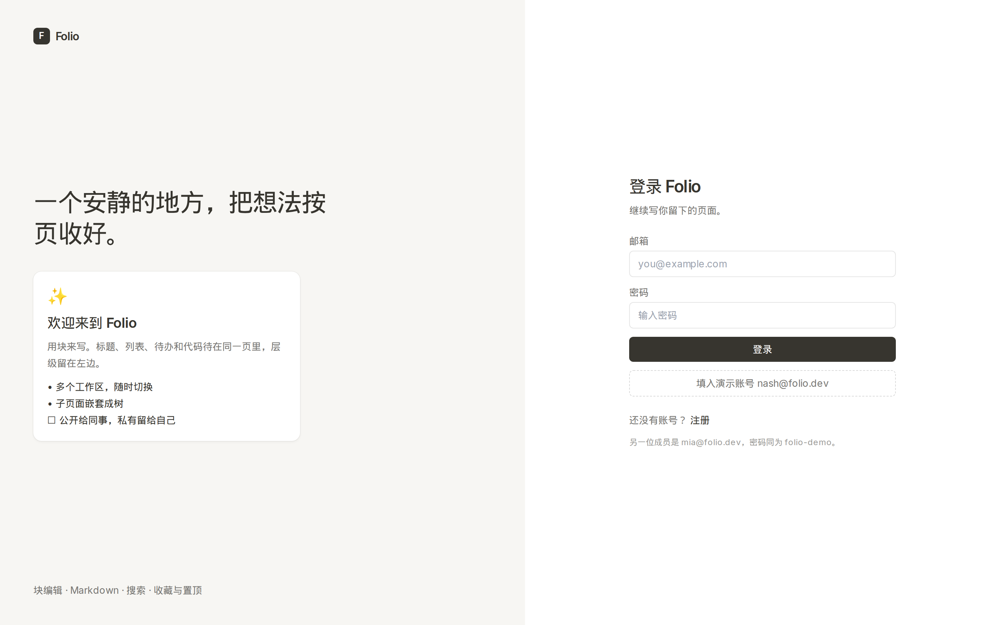
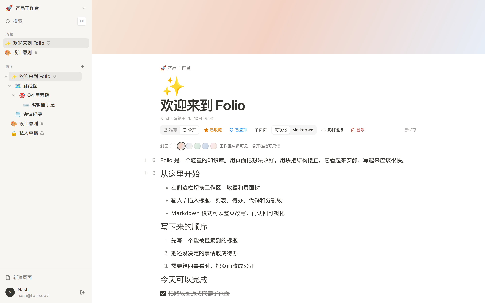
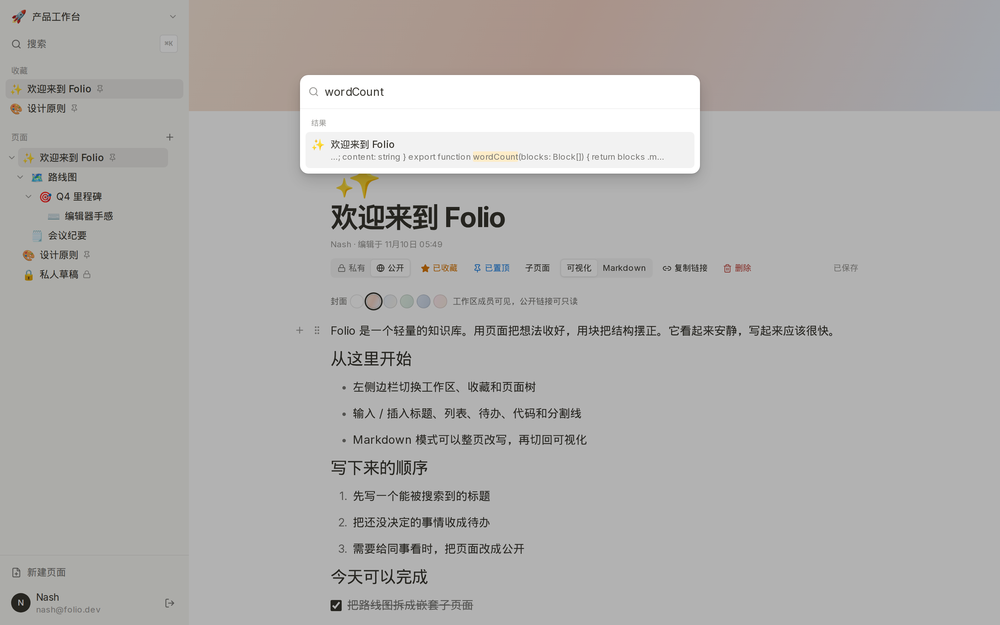
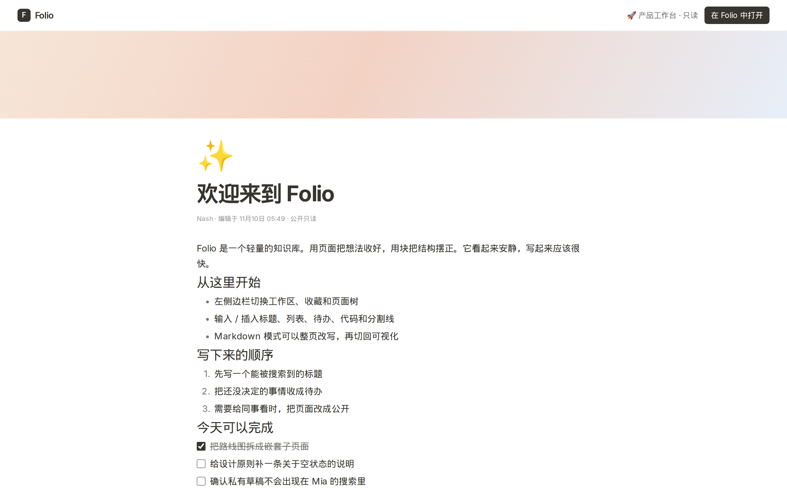
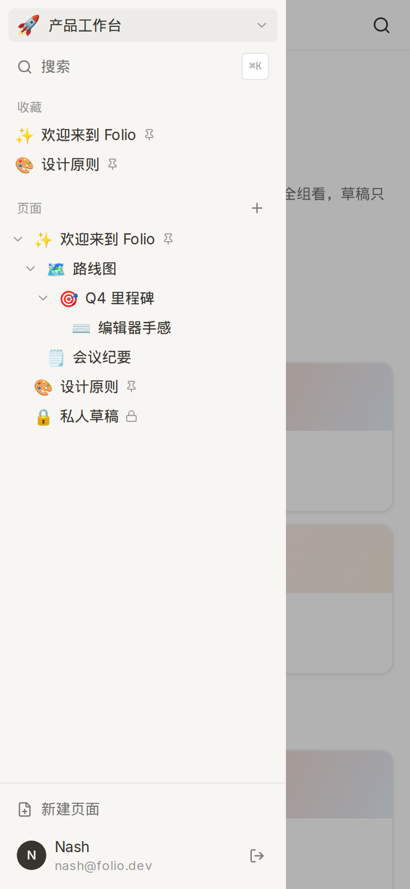

# Folio

一个安静、清晰的块式知识库。可以注册登录，在多个工作区里用嵌套页面写笔记，按块编辑，也可以切到 Markdown。风格尽量靠近 Notion：浅色侧栏、大标题、少装饰。

## 技术栈

- Next.js 15（App Router）+ React 19 + TypeScript
- Tailwind CSS
- Prisma 6 + SQLite
- 自研块编辑器（快捷键、`/` 菜单、Markdown 往返）
- 认证：bcrypt 密码哈希，JWT 放在 HttpOnly cookie
- 测试：Vitest、Playwright

## 本地启动

需要 Node.js 20 或更新版本。

```bash
npm install
cp .env.example .env
npm run setup
npx playwright install chromium
npm run dev
```

浏览器打开 [http://localhost:3000](http://localhost:3000)。`npm run setup` 会生成 Prisma Client、创建 `prisma/dev.db` 并写入种子数据。

生产构建：

```bash
npm run build
npm start
```

## 种子账号

两个账号的密码都是 `folio-demo`。

| 名字 | 邮箱 | 能进的工作区 |
| --- | --- | --- |
| Nash | nash@folio.dev | 产品工作台（所有者）、研究笔记、个人空间 |
| Mia | mia@folio.dev | 产品工作台、研究笔记 |

登录页可以一键填入 Nash 的账号。种子里有三个工作区、多层嵌套页面，以及标题、段落、列表、待办、代码块和分割线。

## 功能

- 注册、登录、退出
- 多个工作区，侧栏里切换
- 页面树，支持嵌套子页面
- 块编辑：标题、段落、无序 / 有序列表、待办、代码块、分割线
- 快捷键：`#`、`##`、`###`、`-`、`1.`、`[]` 加空格，以及 `---` 和 ` ``` `
- Markdown 编辑和预览，可以切回块
- 按标题和正文搜索，私有页只对作者出现
- 收藏（每个人自己的）和置顶（同级排序，看见这篇的人都会看到）
- 私有 / 公开。私有只有作者能打开；公开对工作区成员可见，并有一条只读分享链接
- 空状态、加载骨架、错误提示和保存状态

## 界面

登录。



工作区首页，侧栏里是收藏和嵌套页面。


块编辑。欢迎页包含列表、待办和代码块。



搜索会命中标题和正文，包括代码里的词。



Markdown 源码和预览并排。


公开页可以不登录阅读。



窄屏下侧栏收进抽屉。



## 测试

```bash
npm test
npm run test:e2e
```

`npm test` 跑单元测试，覆盖块编辑、Markdown 往返、搜索排序、页面树、权限和快捷键。

`npm run test:e2e` 会先推送数据库并重新播种，再用 Playwright 打开应用。覆盖错误密码、注册、创建并嵌套页面、编辑块、搜索、切换工作区、收藏、置顶、Markdown、空工作区、私有页和分享链接。第一次跑之前需要 `npx playwright install chromium`。

重置本地数据：

```bash
npm run db:reset
```

## 已知限制

- 没有实时协作。保存是最后一次写入生效。
- 块内没有加粗、斜体或行内链接，也不能上传图片和文件。
- 调整块顺序用块菜单里的上移 / 下移，没有拖拽。
- 公开表示工作区成员可见，外加一条不易猜到的只读链接，不是更细的权限表。
- 置顶跟页面走，收藏跟用户走。
- 数据库是 SQLite，适合单机演示，不适合多进程同时写。
