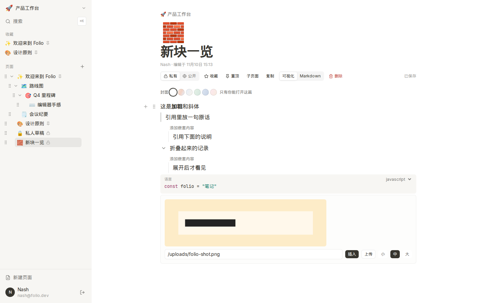
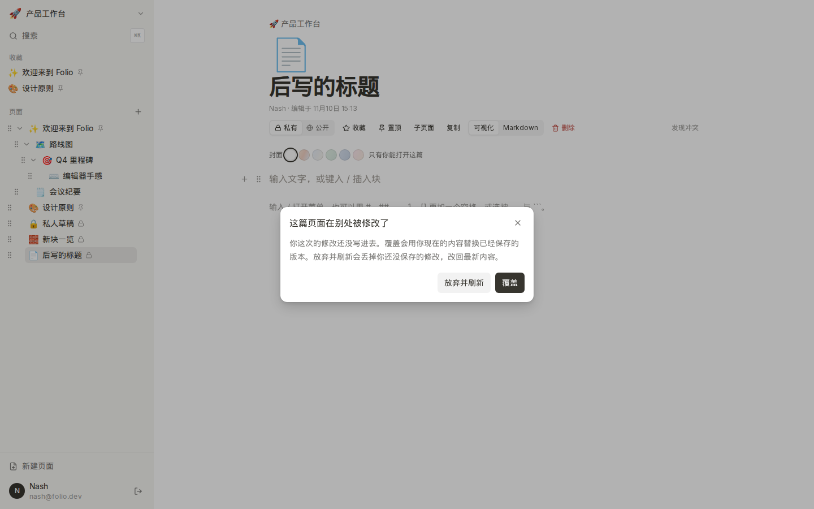
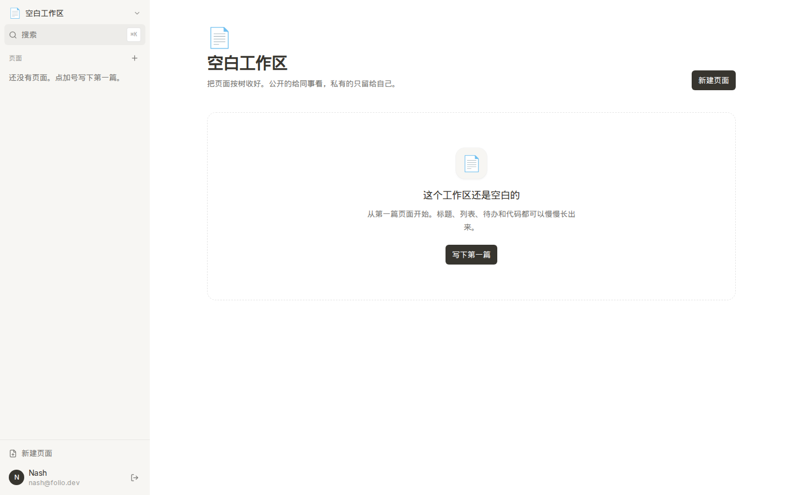

# Folio

一个安静、清晰的块式知识库。可以注册登录，在多个工作区里用嵌套页面写笔记，按块编辑，也可以切到 Markdown。风格尽量靠近 Notion：浅色侧栏、大标题、少装饰。

## 技术栈

- Next.js 15（App Router）+ React 19 + TypeScript
- Tailwind CSS
- Prisma 6 + SQLite
- 自研块编辑器（快捷键、`/` 菜单、Markdown 往返）
- 认证：bcrypt 密码哈希，JWT 放在 HttpOnly cookie
- 测试：Vitest、Playwright

## 本地启动

需要 Node.js 20 或更新版本。

```bash
npm install
cp .env.example .env
npm run setup
npx playwright install chromium
npm run dev
```

浏览器打开 [http://localhost:3000](http://localhost:3000)。`npm run setup` 会生成 Prisma Client、创建 `prisma/dev.db` 并写入种子数据。

GitHub Actions 在每次 push 和 pull request 上跑同一套检查：`npm ci`、lint、typecheck、`npm test`，以及单独的 Playwright job。说明在 [docs/CI_SETUP.md](docs/CI_SETUP.md)。

生产构建：

```bash
npm run build
npm start
```

## 种子账号

两个账号的密码都是 `folio-demo`。

| 名字 | 邮箱 | 能进的工作区 |
| --- | --- | --- |
| Nash | nash@folio.dev | 产品工作台（所有者）、研究笔记、个人空间 |
| Mia | mia@folio.dev | 产品工作台、研究笔记 |

登录页可以一键填入 Nash 的账号。种子里有三个工作区、多层嵌套页面，以及标题、段落、列表、待办、代码块和分割线。

## 功能

- 注册、登录、退出
- 多个工作区，侧栏里切换
- 页面树可以拖拽换顺序、拖进另一页，或拖出来升一级。不能拖进自己或子页面
- 块编辑：标题、段落、无序 / 有序列表、待办、引用、折叠、代码块、分割线、图片
- 块内格式：加粗、斜体、删除线、行内代码、链接。可用 `**`、`*`、`~~`、`` ` `` 和 `[文字](https://…)`，也可以用 Cmd/Ctrl+B、I、Shift+X、E。选中文字后用 Cmd/Ctrl+K 或浮动条添加、修改、移除链接。只接受 http 和 https，`javascript:` 不会变成可点链接。编辑时从小框里的「打开」进入新标签，分享页和 Markdown 预览可以直接点
- 同级块可以拖握把排序，松手后自动保存
- 引用和折叠可以嵌套段落。折叠的收起状态会保存
- 图片可以用 https 地址插入，也可以上传 png / jpeg / gif / webp，并在小、中、大之间切换。默认 `IMAGE_STORAGE=local`，文件在 `public/uploads`。没有持久磁盘时设 `IMAGE_STORAGE=s3`，并配 `S3_BUCKET`、`S3_ENDPOINT`、`S3_ACCESS_KEY_ID`、`S3_SECRET_ACCESS_KEY`、`S3_PUBLIC_BASE_URL`（`S3_REGION` 默认为 `auto`）。变量说明在 `.env.example`，Vercel 这类环境的配法在 [docs/IMAGE_STORAGE.md](docs/IMAGE_STORAGE.md)
- 代码块可选语言。JavaScript、Python、CSS 有基础着色
- 快捷键：`#`、`##`、`###`、`-`、`1.`、`[]` 加空格，以及 `---` 和 ` ``` `
- Markdown 编辑和预览，可以切回块
- 复制页面。可以选择只复制这一页，或连同子页面一起复制。标题会加上「副本」
- 搜索可以看全部、只看标题或只看正文。命中的词会高亮。私有页不会出现在其他人的结果里
- 收藏（每个人自己的）和置顶（同级排序，看见这篇的人都会看到）
- 可见性有三档。私有只有作者能打开。公开只读时，其他成员和分享链接都只能看。公开可编辑时，成员能改正文，但不能改权限、置顶、移动或删除。两种公开链接未登录时都只能阅读
- 空状态、加载骨架、错误提示和保存状态用同一套字号和颜色。窄屏侧栏是抽屉，点进页面、新建或切换工作区后会收起，Esc 也能关掉
- 编辑后约 500 毫秒自动保存。保存失败时提示原因，并可以手动重试
- 同一页在别处保存过时，后提交的人会看到冲突，可以选择覆盖，或放弃并刷新

## 界面

登录。


工作区首页，侧栏里是收藏和嵌套页面。


块编辑。欢迎页包含列表、待办和代码块。


搜索可以切到全部、标题或正文，命中的词会高亮。


引用、折叠、代码着色和本地图片。



别处已经保存过时，后一次修改会停在冲突提示上。



Markdown 源码和预览并排。


公开页可以不登录阅读。


窄屏下侧栏收进抽屉，加号直接可见。


没有页面时，侧栏和主区域用同一套空状态。



## 测试

```bash
npm test
npm run test:e2e
```

`npm test` 跑单元测试，覆盖块编辑、行内格式和链接、Markdown 往返、搜索排序和标题/正文筛选、页面树拖拽和复制、权限矩阵和公开只读/可编辑、快捷键、引用、折叠、图片校验和存储后端、代码着色、剪贴板里的跨块内容，以及大页面里未改动块保持原对象。当前 108 个通过。

`npm run test:e2e` 会先推送数据库并重新播种，再用 Playwright 打开应用。覆盖错误密码、注册、创建并嵌套页面、编辑块、搜索、切换工作区、收藏、置顶、Markdown、空工作区、私有页、分享链接，以及块拖拽、空块光标、富文本保存、斜体对齐、引用、折叠、图片上传、代码高亮、页面树拖拽、页面复制、含图片的页面复制、跨块粘贴、并发冲突、一次和连续多次保存失败后的重试、搜索高亮和范围筛选、私有页搜索隔离、窄屏侧栏、横竖屏切换、行内链接的添加修改移除和分享页点击、公开只读与可编辑、侧栏展开状态跨浏览器保持。当前 56 个通过。第一次跑之前需要 `npx playwright install chromium`。

320 块页面的计时不在默认端到端里。开发模式用 `npx playwright test --config playwright.bench.config.ts`。生产构建先 `npm run build`，再跑 `npx playwright test --config playwright.bench.prod.config.ts`。两次生产测量里，第 320 块在 130 ms 和 165 ms 出现，文档响应是 42 ms 和 59 ms。

阶段说明和总体验收在 [docs/FINAL_AUDIT.md](docs/FINAL_AUDIT.md)。分阶段文档：[docs/EDITOR_RICH_TEXT.md](docs/EDITOR_RICH_TEXT.md)、[docs/EDITOR_DRAG.md](docs/EDITOR_DRAG.md)、[docs/PHASE1_TESTS.md](docs/PHASE1_TESTS.md)、[docs/NEW_BLOCKS.md](docs/NEW_BLOCKS.md)、[docs/PAGE_TREE_OPS.md](docs/PAGE_TREE_OPS.md)、[docs/CONFLICT_AND_SAVE.md](docs/CONFLICT_AND_SAVE.md)、[docs/LARGE_PAGE_TEST.md](docs/LARGE_PAGE_TEST.md)。这一轮加固的自检在 [docs/CI_SETUP.md](docs/CI_SETUP.md)、[docs/INLINE_LINKS.md](docs/INLINE_LINKS.md)、[docs/IMAGE_STORAGE.md](docs/IMAGE_STORAGE.md)、[docs/PERMISSIONS_AND_TOGGLE.md](docs/PERMISSIONS_AND_TOGGLE.md) 和 [docs/FOLIO_NEXT_AUDIT.md](docs/FOLIO_NEXT_AUDIT.md)。

重置本地数据：

```bash
npm run db:reset
```

## 已知限制

- 没有实时协作。同一页在别处已经保存时，后提交会停在冲突提示上，要选择覆盖或放弃并刷新。
- 块内有加粗、斜体、删除线、行内代码和链接。斜体用倾斜变换，占位宽度和光标一致。链接只接受 http 和 https，编辑时要点「打开」，分享页和预览里可以直接点。
- 可以上传图片。单张不超过 2MB，只接受 png、jpeg、gif、webp。默认写在本机 `public/uploads`，没有持久磁盘时要改成对象存储。
- 同级块可以拖拽排序。页面树可以换顺序和层级；置顶页仍排在同级未置顶页前面。
- 公开分成只读和可编辑。可编辑的成员能改正文，不能改权限、置顶或删除。公开链接两种都只能阅读。侧栏展开状态按用户保存在服务端。
- 在 Folio 里跨块复制会带上格式、链接和空块。贴到别的程序时只剩 Markdown 或纯文本，空段落可能被折掉。
- 置顶跟页面走，收藏跟用户走。
- 数据库是 SQLite，适合单机演示，不适合多进程同时写。
